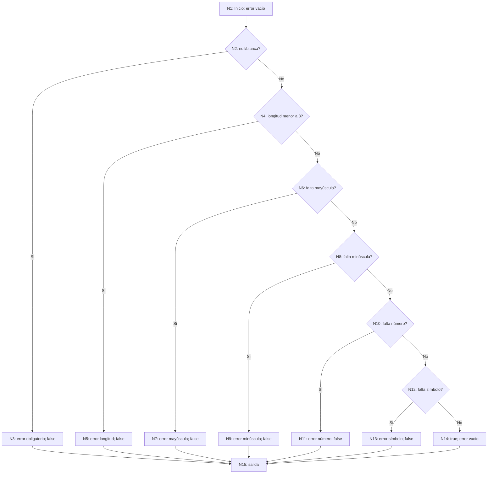

# BLOQUE 12 — Tests académicos

## Referencia vigente — 27/10/2026

Código inspeccionado: `master`, `8e17456`. Último resultado ejecutado registrado: **248 pruebas no SQL aprobadas, 0 fallos**, build sin errores y 26 CS8618 existentes; incluye 27 casos de `AutorizacionOperacionesP1Tests`. No se ejecutó de nuevo en esta actualización documental. La comparación modelo/snapshot forma parte de la suite; no prueba las migraciones aplicadas ni la integridad de una base.

La suite actual combina comportamiento de componentes, filtros en memoria, metadatos/traducción EF sin conexión y comprobaciones estructurales. Los tests que leen fuentes no equivalen a operaciones HTTP/SQL completas. La aceptación está en [ACEPTACION-1.0.md](ACEPTACION-1.0.md).

Ejecutar sólo el proyecto principal con `--filter 'FullyQualifiedName!~OnboardingSqlIntegrationTests'` para la suite no SQL. Onboarding SQL es opt-in y escribe fixtures en la base habitual autorizada: no comparte el aislamiento del [harness de concurrencia](../tests/MecaniCar360.ConcurrencyTests/README.md). Sus 28 escenarios siguen sin ejecutar; preparación y ejecución necesitan autorización separada. B1 no acredita espera observada en SQL.

## Antecedente histórico: bloque académico original

Los checkpoints, herramientas de ejecución y resultados de las secciones numeradas siguientes corresponden al bloque original y a sus actualizaciones fechadas; no son el inventario ni el resultado completo vigente.

> Referencia histórica del bloque original. Resultado historico del 15/10/2026: 221 pruebas no SQL aprobadas, 0 fallos; build 0 errores y 26 CS8618. Los recuentos originales siguientes no describen la suite completa actual. Ver [operación local](OPERACION-LOCAL-1.0.md), [advertencias](ADVERTENCIAS-1.0.md) y [aceptación pendiente](ACEPTACION-1.0.md). Ejecutar la suite actual con `--filter 'FullyQualifiedName!~OnboardingSqlIntegrationTests'`; no ejecutar integración SQL implícitamente.

## 1. Objetivo y estrategia

Dejar una batería permanente, reproducible y trazable que demuestre pruebas unitarias, caja negra con partición de equivalencia y valores límite, y caja blanca mediante camino básico. Se seleccionaron reglas existentes; no se cambiaron reglas para facilitar los tests. Esta suite no reemplaza las aceptaciones funcionales de los bloques anteriores ni afirma cobertura total.

Checkpoint inspeccionado: `d1b88b1`. Antes del bloque no existía un proyecto de tests ni tests xUnit/NUnit/MSTest en el repositorio. Los harness temporales anteriores no se contabilizan como pruebas permanentes.

## 2. Niveles, entorno y herramientas

- Unitario: serialización/hashing de integridad y política de contraseñas.
- Unitario de contrato: DataAnnotations de puntuación de CalificacionTrabajo.
- Consistencia de metadatos: modelo EF frente al snapshot, sin conexión SQL.
- No se necesita integración contra una base temporal para los caminos seleccionados. No se ejecuta integración SQL ni navegador en esta suite.
- .NET 8; SDK de ejecución 9.0.312; xUnit 2.9.2, runner Visual Studio 2.8.2 y Microsoft.NET.Test.Sdk 17.11.1. Las versiones están fijadas en el proyecto.

Proyecto: `tests/MecaniCar360.Tests/MecaniCar360.Tests.csproj`, incluido en `MecaniCar360.sln`. Referencia el proyecto productivo. El proyecto web excluye el código y contenido de tests de su compilación/publicación.

No se ejecuta Program, seed o migraciones. No se leen appsettings/User Secrets ni se envía correo. Las entradas de contraseña de los tests son datos ficticios, no cuentas existentes. Las fechas son fijas y el test de cultura restaura la cultura en finally. Cada test construye sus propios objetos; no depende del orden ni de recursos compartidos persistentes.

## 3. Pruebas unitarias de integridad

Código probado: [SerializadorCanonico](../Data/Integridad/SerializadorCanonico.cs). Tests: [SerializadorCanonicoTests](../tests/MecaniCar360.Tests/SerializadorCanonicoTests.cs).

| ID | Entrada/condición | Esperado | Test automatizado |
|---|---|---|---|
| UT-01 | null | `N;` | Token_Null_ProduceMarcadorNulo |
| UT-02 | string vacío frente a null | `V0:;`, DVH distintos | Token_Vacio_SeDistingueDeNull |
| UT-03 | delimitadores en campos y particiones diferentes | Longitud explícita y hashes diferentes | Dvh_DelimitadoresEnCampos_NoConfundeParticiones |
| UT-04 | `ñ🚗` | `V6:ñ🚗;`, seis bytes UTF-8 | Token_TextoMultibyte_CuentaBytesUtf8 |
| UT-05 | 12.5m, 12.50m, 12.5000m | `V5:12.50;` | Token_Decimal_UsaDosDecimalesInvariantes |
| UT-06 | Fecha fija con 7 dígitos fraccionarios y Kind distinto | Representación exacta sin conversión horaria | Token_Fecha_ConservaPrecisionSinConvertirZona |
| UT-07 | Mismos valores con es-AR y en-US | Mismo DVH y decimal invariante | Dvh_CulturasEsArYEnUs_ProduceMismoHash |
| UT-08 | Personas, clave 7, Ana; repetido | SHA-256 conocido versión 1 | Dvh_VectorVersionUno_CoincideConSha256Conocido |
| UT-09 | Claves 7 y 8 con datos iguales | DVH diferentes | Dvh_CambioDeClave_CambiaHash |
| UT-10 | Tabla Personas vacía | DVV conocido de cabecera y cero filas | Dvv_TablaVacia_CoincideConVectorConocido |
| UT-11 | Clave compuesta (1,23) frente a (12,3), y cantidad distinta | Determinismo e inequivalencia de entradas distintas | Dvv_ClaveCompuestaOCantidadDistinta_CambiaHash |

Los vectores conocidos se calcularon independientemente sobre los literales canónicos `MC360|DVH|1|V8:Personas;|V1:7;|V3:Ana;` y `MC360|DVV|1|V8:Personas;|V1:0;`. No se genera el valor esperado llamando al mismo método probado. Los ejemplos no pretenden demostrar ausencia matemática de colisiones SHA-256 ni el ordenamiento SQL: el serializador recibe filas ya ordenadas.

## 4. Caja negra: partición de equivalencia

Funcionalidad: aceptación de la propiedad entera `CalificacionTrabajo.Puntuacion` por su contrato `[Range(1,5)]`. Código: [CalificacionTrabajo](../Models/Clases/CalificacionTrabajo.cs). Se invoca `Validator.TryValidateProperty`, sin inspeccionar la implementación interna de RangeAttribute. El oráculo es el intervalo inclusivo especificado por el dominio.

Dominio: enteros representables por Int32. No se prueba conversión de texto/model binding. Para un valor inválido se espera false y exactamente un error; para uno válido, true y ningún error.

| ID | Clase | Representante | Esperado | Test |
|---|---|---:|---|---|
| BN-01 | Inválida: x < 1 | -10 | false, un error | Puntuacion_RepresentanteDeClase_ValidaSegunContrato(-10,false) |
| BN-02 | Válida: 1 ≤ x ≤ 5 | 3 | true, sin errores | Puntuacion_RepresentanteDeClase_ValidaSegunContrato(3,true) |
| BN-03 | Inválida: x > 5 | 10 | false, un error | Puntuacion_RepresentanteDeClase_ValidaSegunContrato(10,false) |

Esta prueba NO ejecuta CalificacionTrabajoService.CrearAsync: no demuestra permisos, ownership, estado Entregado, unicidad ni el CHECK SQL. La misma regla 1..5 también aparece en ese servicio, pero no se atribuye cobertura del servicio a estos tests.

## 5. Análisis de valores límite

Misma regla, dominio discreto. Frontera inferior 1, frontera superior 5. Se eligen el límite y sus vecinos inmediatos.

| ID | Posición | Valor | Esperado | Test |
|---|---|---:|---|---|
| BL-01 | Inferior − 1 | 0 | false, un error | Puntuacion_ValorEnFrontera_ValidaSegunContrato(0,false) |
| BL-02 | Inferior | 1 | true, sin errores | Puntuacion_ValorEnFrontera_ValidaSegunContrato(1,true) |
| BL-03 | Inferior + 1 | 2 | true, sin errores | Puntuacion_ValorEnFrontera_ValidaSegunContrato(2,true) |
| BL-04 | Superior − 1 | 4 | true, sin errores | Puntuacion_ValorEnFrontera_ValidaSegunContrato(4,true) |
| BL-05 | Superior | 5 | true, sin errores | Puntuacion_ValorEnFrontera_ValidaSegunContrato(5,true) |
| BL-06 | Superior + 1 | 6 | false, un error | Puntuacion_ValorEnFrontera_ValidaSegunContrato(6,false) |

## 6. Caja blanca: método seleccionado

[PasswordValidator.EsValida](../Helpers/PasswordValidator.cs) es un método real y determinista de producción, con seis decisiones de negocio y retornos tempranos. Permite aislar todos los caminos sin introducir mocks, SQL o cambios de arquitectura. Se eligió este helper en lugar de un Service con infraestructura porque contiene la política completa que interesa probar.

Orden real de decisiones: entrada null/blanca; longitud menor que 8; falta de mayúscula ASCII; falta de minúscula ASCII; falta de número según Regex `\d`; falta de símbolo según Regex `[^a-zA-Z0-9]`; aceptación. Inicializa error a string vacío y cada rechazo establece un mensaje distinto antes de devolver false. No existe else ni switch.

El grafo considera IsNullOrWhiteSpace y cada Regex.IsMatch como llamadas atómicas. No expande internamente .NET ni el motor Regex; no hay condiciones booleanas compuestas en los seis if. Se modela el flujo normal de ejecución, no excepciones de infraestructura/runtime.

## 7. Grafo de flujo y nodos



Numeración textual: N1 inicialización; N2/N4/N6/N8/N10/N12 predicados en el orden indicado; N3/N5/N7/N9/N11/N13 retornos de error correspondientes; N14 aceptación; N15 salida común sintética para unificar los siete returns.

Aristas: (1,2), (2,3), (2,4), (3,15), (4,5), (4,6), (5,15), (6,7), (6,8), (7,15), (8,9), (8,10), (9,15), (10,11), (10,12), (11,15), (12,13), (12,14), (13,15), (14,15).

## 8. Complejidad ciclomática

N = 15 nodos; E = 20 aristas; P = 1 componente conectado.

**V(G) = E − N + 2P = 20 − 15 + 2 = 7.**

Contraste: seis nodos predicado + 1 = **7**. La cantidad de caminos de la base coincide con V(G); no se confunde con los nueve casos parametrizados.

## 9. Base de caminos y casos

Todos usan el test `EsValida_PrimerRequisitoIncumplido_DevuelveResultadoYMensajeEsperados` de [PasswordValidatorTests](../tests/MecaniCar360.Tests/PasswordValidatorTests.cs). Se comparan tanto bool como mensaje exacto.

| ID | Entrada ficticia / precondición | Camino | Resultado esperado |
|---|---|---|---|
| WB-01 | null; adicionales vacío y tres espacios | P1: 1-2-3-15 | false; «La contraseña es obligatoria.» |
| WB-02 | `Aa1!abc` (7 caracteres) | P2: 1-2-4-5-15 | false; «Debe tener al menos 8 caracteres.» |
| WB-03 | `aa1!abcd` (resto satisfecho) | P3: 1-2-4-6-7-15 | false; «Debe contener al menos una letra mayúscula.» |
| WB-04 | `AA1!ABCD` | P4: 1-2-4-6-8-9-15 | false; «Debe contener al menos una letra minúscula.» |
| WB-05 | `Aa!!abcd` | P5: 1-2-4-6-8-10-11-15 | false; «Debe contener al menos un número.» |
| WB-06 | `Aa12abcd` | P6: 1-2-4-6-8-10-12-13-15 | false; «Debe contener al menos un símbolo.» |
| WB-07 | `Aa1!abcd` (8 caracteres y todo satisfecho) | P7: 1-2-4-6-8-10-12-14-15 | true; error vacío |

P1 introduce la salida de N2; P2 agrega (2,4); P3 agrega (4,6); P4 agrega (6,8); P5 agrega (8,10); P6 agrega (10,12); P7 agrega (12,14). Cada camino agrega al menos una arista no recorrida por los anteriores. Las entradas satisfacen todas las decisiones previas al rechazo seleccionado; los siete caminos son técnicamente alcanzables y se automatizan como unit tests.

## 10. Trazabilidad y resultados

Los identificadores y entradas de las tablas anteriores individualizan los casos; los nombres completos de métodos enlazan cada técnica con su implementación.

| ID | Técnica | Funcionalidad | Test automatizado | Resultado obtenido |
|---|---|---|---|---|
| UT-01–UT-11 | Unit | DVH/DVV | Once métodos de SerializadorCanonicoTests, detallados arriba | PASS: obtenido coincide con lo esperado |
| BN-01–BN-03 | Equivalencia | Puntuación | Puntuacion_RepresentanteDeClase_ValidaSegunContrato, tres filas | PASS: obtenido coincide con lo esperado |
| BL-01–BL-06 | Límite | Puntuación | Puntuacion_ValorEnFrontera_ValidaSegunContrato, seis filas | PASS: obtenido coincide con lo esperado |
| WB-01–WB-07 | Camino básico | Política de contraseña | EsValida_PrimerRequisitoIncumplido_DevuelveResultadoYMensajeEsperados, nueve filas | PASS: obtenido coincide con lo esperado |
| EF-01 | Metadatos | Alineación EF | ModeloActual_ContraSnapshot_NoTieneCambiosPendientes | PASS: obtenido coincide con lo esperado |

El test EF-01 espera false de HasPendingModelChanges y conexión Closed. Usa una cadena ficticia local con puerto 1, no la configuración del usuario, y no abre conexión. No demuestra estado de migraciones aplicadas en ninguna base.

## 11. Defectos, correcciones y límites

La ejecución del 05/10/2026 terminó con 30 PASS, 0 FAIL y 0 SKIP en 3,7456 segundos reportados por VSTest (sin contar restore/build). Todos los bool, mensajes, tokens, hashes conocidos y relaciones esperadas de las tablas anteriores coincidieron con lo obtenido. No se encontraron defectos funcionales ni se hicieron correcciones productivas. El primer intento no llegó a ejecutar tests por MSB3027/MSB3021: la aplicación abierta bloqueaba su DLL. Se resolvió aislando artefactos, sin detenerla ni alterar código de negocio. La cobertura de los siete caminos se justifica por las entradas y el grafo; no se midió porcentaje de cobertura global ni se usó instrumentación de cobertura.

No se demuestra seguridad completa, matriz de permisos, persistencia SQL, transacciones, concurrencia, UI, validación de correo o Unicode exhaustivo de contraseñas. La suite prueba el contrato vigente, sin reformularlo. No requiere bases temporales ni limpieza de fixtures. No repite CORE ni las aceptaciones anteriores.

## 12. Ejecución reproducible

Desde la raíz:

```powershell
dotnet test MecaniCar360.sln -p:UseAppHost=false
dotnet build MecaniCar360.sln -p:UseAppHost=false
```

También se puede ejecutar simplemente `dotnet test` desde `tests/MecaniCar360.Tests`. La primera ejecución necesita restaurar paquetes NuGet. UseAppHost=false evita generar el ejecutable nativo, pero NO evita el bloqueo de la DLL de una aplicación abierta. Con la app en ejecución, usar la variante aislada indicada abajo; los tests no necesitan iniciarla. Sin parámetros de logger no se generan informes TRX ni archivos de resultados en el repositorio. bin/obj son artefactos normales ignorados por Git.

Los tests son independientes de SQL Server, de una sesión autenticada y de la disponibilidad de SMTP. La ejecución final registra total, PASS/FAIL/SKIP y duración a continuación.

Con la aplicación abierta, desde la raíz (comandos usados en esta validación):

```powershell
dotnet test MecaniCar360.sln --artifacts-path "$env:TEMP\MecaniCar360-Tests12" -p:UseAppHost=false --logger "console;verbosity=normal"
dotnet build MecaniCar360.sln --artifacts-path "$env:TEMP\MecaniCar360-Tests12" -p:UseAppHost=false
```

Resultado: 30 casos, 30 PASS, 0 FAIL, 0 SKIP. EF-01 PASS confirma HasPendingModelChanges=false sin conexión SQL. La duración indicada es una observación de esta ejecución, no un umbral de rendimiento.


## Calificación posterior a entrega e inicio en Agenda (cambio local sobre 2446b13)

La notificación de entrega utiliza SolicitudCalificacion = 8 + RecursoId (OT), independiente del título visible, para ofrecer el acceso a calificar la OT entregada. No se emite otra notificación. Su respuesta se deriva de la existencia de Calificacion, independientemente de Leida. Compatibilidad histórica de sólo lectura: OrdenPropia = 1 más el título antiguo exacto «Vehículo entregado» conserva el acceso. Ese tipo también identifica «Vehículo listo para retirar», por lo que no se interpreta cualquier OrdenPropia como solicitud. Las nuevas entregas sólo emiten el tipo 8; no se modifican filas históricas ni se renumeran los valores 1–7. Cambiar el título de una nueva solicitud no afecta su reconocimiento; una fila histórica sin identificador explícito sigue necesitando el título original. Otros avisos mantienen su destino anterior. TipoRecurso es una columna int nullable existente; no se agrega esquema.

CrearAsync exige CLIENTE activo y habilitado, sin perfil interno activo, propietario de la OT y titular actual del vehículo. Mantiene puntuación 1–5, comentario opcional de hasta 1000 caracteres y una calificación por OT. ADMIN conserva consulta, pero no creación. La UI utiliza radios con etiquetas y estrellas; el servidor revalida al guardar.

La transacción Serializable comienza antes de las lecturas decisivas. IntegridadTransactionInterceptor adquiere el mutex global al comenzar; luego se consultan proyecciones sin tracking de cuenta/orden/titularidad/calificación. SaveChanges y commit permanecen dentro de esa transacción y se conserva el índice único de OrdenTrabajoId. No se cambia EntregarAsync ni su política transaccional.

Pruebas no SQL: CalificacionEntregaTests ejecuta filtros y reglas reales en memoria, validaciones de entrada, proyección de solicitudes pendientes/respondidas y traducción SQL sin abrir conexión; complementa con inspección estructural de transacción, ownership y contrato MVC. InicioAgendaTests ejecuta el selector de destinos con permisos simulados. Estas pruebas **no ejecutan CrearAsync con persistencia exitosa**, la habilitación completa contra SQL, login HTTP ni carreras reales.

Pendiente con autorización separada y base SQL aislada:
1. Cliente habilitado propietario: entregar OT ficticia, comprobar un solo aviso, calificar desde él y consultar resultado. Marcar leído antes de responder no debe cambiar el estado de solicitud.
2. Rechazos sin inserciones: OT no entregada, otro cliente, titularidad finalizada, CLIENTE pendiente/inactivo, perfiles internos (incluido mixto CLIENTE+ADMIN), puntuación/comentario inválidos y duplicado.
3. Dos DbContext/conexiones independientes califican simultáneamente la misma OT: exactamente una fila; segundo intento rechazado, sin considerar timeout/deadlock como rechazo válido.
4. Fallo inyectado después del INSERT y antes del commit: un tercer contexto debe comprobar ausencia de calificación parcial y conservación de notificación, estado de OT e integridad DVH/DVV aplicable. Descartar el contexto fallido.
5. Cuenta/OT precargada antes de una modificación concurrente: comprobar que se rechaza con el estado vigente. Validar orden de bloqueo frente a entrega y otras escrituras.
6. Login ADMIN y CAJA estándar con TURNO_VER abre Turno/Agenda; MECANICO/STOCK/CLIENTE conservan destino. Dashboard sigue accesible con DASHBOARD_VER. Probar logo, Inicio, primer ingreso, denegación y permisos personalizados.

No usar MecaniCar360 ni TEST_CIERRE10_A123 para esta campaña. No se ejecutaron SQL, migraciones, seeds, navegador ni escenarios opt-in durante la implementación. En navegador quedan pendientes radios con flechas/Tab/Space, foco visible, lector de pantalla, anchos móviles y recorrido de notificación ajena. La campaña de 28 escenarios existente conserva su limitación B1.


## Formularios y mutaciones — revisión del 01/11/2026

Referencia inspeccionada: [clase 12 MDW 2026](https://dariomaranes.github.io/UAI-MDW-2026/clase-12/index.html). Base: `d38ec01` más los cambios locales de esta tarea. Esta sección registra implementación y límites; no certifica aceptación en navegador. La segunda pasada de cierre se detalla al final.

### Aplicación a MVC y alcance comprobado

Los controladores validan `ModelState`, los servicios devuelven `ServiceResult` y aplican permisos, ownership y reglas. Los formularios nativos conservan POST y antiforgery. El actor se obtiene de Claims, no de un campo editable. Tras éxito, las redirecciones producen un GET que consulta información nuevamente: no hacen falta Server Actions, AJAX ni invalidaciones de caché de Next.js. Esto no garantiza que una pestaña ya abierta o una página restaurada desde la caché del navegador muestre datos actuales; antes de una acción crítica debe revisarse el estado y el servicio debe revalidarlo.

Inventario de acciones POST de los módulos solicitados (los nombres corresponden a sus controladores; revisión estática, no ejecución funcional):

| Módulo / operaciones | Validación, rechazo y conservación | Éxito / actualización |
|---|---|---|
| Turno: Crear | `ModelState`, errores del servicio y reconstrucción de opciones; conserva ViewModel | Redirección existente |
| Turno: Confirmar, Cancelar, ClienteAusente, Reprogramar | Confirmación/ausencia mantienen TempData. **Corregido:** cancelación/reprogramación recuperan entrada y errores en detalle autorizado; horarios se vuelven a consultar y sólo se reseleccionan si siguen disponibles | GET de detalle; estado revalidado en servicio |
| Turno: CrearPropio, CancelarPropio | Contratos HTTP auxiliares, no confundirlos con los formularios HTML del portal | Respuestas HTTP existentes; sin conversión a MVC HTML |
| Vehiculo: Crear, Editar, CambiarEstado | Alta/edición conservan modelo y catálogos; estado usa mensaje general | PRG existente |
| IngresoVehiculo: Registrar | Conserva ViewModel y recarga información de pantalla; servicio revalida turno | PRG existente; no se modifica la atomicidad de ingreso/OT |
| OrdenTrabajo: AsignarMecanico, TomarOrden, IniciarReparacion, Finalizar, Entregar, CambiarUrgencia, ActualizarObservaciones, ActualizarCostoDiagnostico | **Corregido:** Finalizar, ActualizarObservaciones y ActualizarCostoDiagnostico conservan entrada/errores y no invocan escritura con binding inválido; reconstruyen detalle autorizado. Las otras transiciones conservan mensajes/redirección | GET de detalle; ADMIN asigna, MECANICO toma; no se amplían permisos |
| Diagnostico: Iniciar, Guardar | Corregido en segunda pasada: Guardar conserva descripción/ModelState y reutiliza un parcial con controles de acceso y estado | GET de OT tras éxito; error reconstruye formulario desde consulta autorizada de OT |
| Presupuesto: Crear, AgregarItem, EliminarItem, EnviarAprobacion, Aprobar, Rechazar | Corregido en segunda pasada: recupera formulario autorizado, entrada y evidencias; ErrorOperacion es fallback si falta contexto o cambia el recurso/versión | PRG a Detalle/Propio; decide sólo propietario habilitado; versiones no se sustituyen al reintentar |
| Stock: Crear, Editar, CambiarEstado | Alta/edición ya conservan modelo y opciones; cambio de estado no requiere borrador | PRG existente |
| Stock: RegistrarIngreso, RegistrarSalida, RegistrarAjuste | **Corregido:** error de binding junto al campo y resumen; rechazo de servicio general; vuelve al detalle autorizado con ModelState, datos y opciones actuales. Se distingue el formulario rechazado para no copiar cantidad/observaciones a otro | PRG sólo tras éxito; sin cambio del servicio ni de lotes |
| Stock: AgregarProveedor, CambiarProveedorPrincipal, ActualizarPrecio, EliminarProveedor | Corregido en segunda pasada: asociación/precio conservan entrada y opciones; sólo la fila rechazada se abre y recupera su precio | GET de asociaciones |
| Proveedor: Crear, Editar, CambiarEstado | Alta/edición conservan modelo y mensajes; estado sin datos adicionales | PRG existente |
| Factura: Emitir, RegistrarPago | Pago conserva ViewModel y recarga factura; **conserva SaldoEsperado original**, no permite convertir un reintento en un cobro nuevo | PRG existente; no se altera control de saldo ni transacción |
| Garantia: Crear, Anular | **Corregido Crear:** binding y negocio vuelven a la vista, recuperan selección y valores desde ModelState y reconstruyen ítems autorizados. Anulación mantiene su mensaje | PRG tras éxito; si ya no es elegible, no se ofrecen ítems obsoletos |
| Calificacion: Crear | **Corregido:** ya no devuelve JSON de ModelState al formulario HTML; conserva modelo, separa error general y errores de campos. Reconsulta acceso/elegibilidad y oculta formulario si dejó de corresponder | PRG tras éxito; una calificación existente no se convierte en otra escritura |
| Usuario: NuevoPersonal, Crear, Editar, CambiarEstado | Alta/edición ya devuelven modelo y reconstruyen opciones donde corresponde; no se almacenan credenciales en el navegador | PRG existente |
| PortalCliente: MisDatos, NuevoVehiculo, NuevoTurno, CancelarTurno | Formularios principales conservan ViewModel/opciones; cancelación conserva contrato existente | PRG y consultas propias; ownership sigue en servidor |

El inventario no convierte el atributo de un controlador en prueba de autorización completa. Los tests de permisos, ownership, concurrencia y modelos existentes siguen vigentes; falta comprobar los resultados persistidos en un entorno autorizado.

### Componente compartido

`wwwroot/js/forms.js`, cargado al final de `_Layout`, añade feedback a POST nativos del mismo origen y ventana. Respeta confirmaciones canceladas, validación HTML/unobtrusive y handlers que cancelan el envío. Excluye GET, destinos externos/otras ventanas, `data-ajax="true"` y `data-mc-submit="false"`. No intercepta ni reemplaza la escritura con fetch. No toca las vistas `Layout = null`.

- Publica «Procesando…» con `role=status` y `aria-busy`; bloquea un segundo submit por clic o Enter. Deshabilita los submitters después de su serialización para conservar nombre/valor. No deshabilita campos ni antiforgery.
- Al volver con `pageshow`, o si un handler cancela el envío, restaura sólo los botones que habilitó el componente y el estado previo de `aria-busy`.
- «Recuperar formulario» permite recuperar una navegación interrumpida, previa advertencia de resultado incierto. **No reenvía**. Antes de repetir, comprobar si se guardó: ni un timeout ni una red interrumpida prueban rollback. No se desbloquea por temporizador ni se reintenta automáticamente.
- Asocia mensajes MVC `data-valmsg-for` a controles del mismo formulario con IDs únicos y `aria-describedby`, conservando ayudas existentes. Actualiza `aria-invalid` al cambiar el mensaje. No inventa etiquetas ni cambia validaciones. Esta mejora requiere JS; no certifica toda la accesibilidad sin JS.
- No guarda borradores, secretos ni valores en localStorage, sessionStorage o cookies. El servidor conserva únicamente la entrada en la respuesta al rechazo; las opciones retiradas/inaccesibles no se reintroducen.

### Doble envío: límites de servidor y trabajo detenido

El feedback no es idempotencia. Se inspeccionaron las protecciones existentes: transacciones de turnos/recepción/toma de OT, decisión de versiones de presupuesto, unicidad de factura/garantía/calificación y validación de saldo esperado en pagos. No se modificaron ni se probaron carreras SQL.

`StockService.Lotes.RegistrarIngresoAsync`, `RegistrarSalidaAsync` y los ajustes manuales validan y serializan operaciones, pero dos POST válidos sucesivos pueden representar dos movimientos. No se agregó una clave de idempotencia ni se cambió la regla de negocio. Para comprobarlo: en base aislada, repetir la misma operación y comparar movimientos/lotes/saldo/auditoría; distinguir dos movimientos intencionales de un reintento requiere acordar el contrato antes de modificar persistencia.

**Actualización:** se corrigieron las brechas de diagnóstico, presupuesto y asociaciones señaladas en la primera pasada. No se restauran acciones cuando se perdió acceso o elegibilidad, ni se sustituye una versión obsoleta. Ver detalles de la segunda pasada al final.

Tampoco se clasificaron mensajes de `ServiceResult` comparando texto: hay validaciones de entrada dentro de servicios que devuelven un mensaje general sin clave de campo. Incorporar errores tipados afectaría contratos; se conserva el mensaje general y no se duplica la regla en JavaScript.

### Evidencia automatizada y pendientes

Ejecutado en la primera pasada (histórico):

```powershell
dotnet build MecaniCar360.csproj --configuration CierreB -p:UseAppHost=false -v:q
dotnet test tests/MecaniCar360.Tests/MecaniCar360.Tests.csproj --configuration CierreB -p:UseAppHost=false --filter 'FullyQualifiedName!~OnboardingSqlIntegrationTests' -v:q
node --test tests/browser/forms.test.cjs
git diff --check
```

`FormulariosMutacionesTests` agrega doce casos: rechazos reales de controlador/servicio con un doble ADO.NET en memoria que no permite escrituras ni transacciones; conservación de ModelState/selección; denegación de acceso al reconstruir formularios; más una comprobación estructural de contratos Razor. No prueba creación exitosa ni renderizado HTML completo. `tests/browser/forms.test.cjs` ejecuta el JS con un DOM doble usando únicamente Node y su runner incorporado: doble submit, controles inicialmente deshabilitados, cancelaciones, recuperación, exclusiones y asociación dinámica de errores. **No es una prueba de navegador**. Node es sólo necesario para esa comprobación, no para ejecutar MVC.

Build: 0 errores y 26 CS8618 conocidas. Suite .NET de la primera pasada: 349 aprobadas, 0 fallidas, integración SQL opt-in excluida. JavaScript: 14 aprobadas con DOM doble. Diff sin errores de whitespace, incluidos archivos nuevos. No se inició la aplicación ni se ejecutó SQL, SMTP, OAuth, migraciones o seeds.

Pendientes de navegador y dispositivo real, complementando la matriz de CONVENCIONES-VISUALES:

1. En cada formulario cambiado, provocar un error de formato y un rechazo de negocio; verificar campo/resumen, valores, selección y permiso vigente. Corregir y guardar una sola vez; comprobar GET y datos persistidos sólo con autorización SQL.
2. Probar 320, 375, 768 y 1366 px, zoom 200 %, Tab/Enter, lector de pantalla y radios de calificación. Mensajes, recuperación y botones alcanzables; sin desbordamiento ni foco invisible.
3. En teléfono real: teclado abierto, botón alcanzable, campos sin zoom inesperado, toque y doble toque, red lenta, cancelación de navegación y regreso con Back. Comprobar el estado antes de cualquier reintento tras interrupción.
4. Verificar que un botón con nombre/valor siga enviándolo, que las confirmaciones canceladas no bloqueen y que un campo inválido no inicie el estado pendiente.
5. Comprobar menú Mi cuenta, logout y formularios con scripts propios; las páginas independientes de activación/restablecimiento deben conservar aislamiento.

Todas estas comprobaciones están **NO EJECUTADAS**. No se declara aceptación integral ni equivalencia entre las pruebas en memoria y concurrencia SQL.


### Segunda pasada — cierre de brechas de formularios (01/11/2026)

- **Diagnóstico:** `Guardar` conserva descripción/ModelState, consulta `OrdenTrabajoService.ObtenerPorIdAsync` (permiso y alcance) y presenta `Views/Diagnostico/Guardar.cshtml`. El formulario se extrajo a `_Formulario.cshtml` y se reutiliza desde OT: mismos campos, POST, antiforgery, asignación y estados. Error de campo junto a descripción; negocio en resumen. `Iniciar` sólo envía ID. No hay otro editor ni selector HTML de evidencias de diagnóstico: no se inventó uno.
- **Presupuesto:** cada alta de ítem es un POST; no hay grilla editable dinámica. Se recuperan descripción/cantidad/precio/repuesto, evidencias al enviar y motivo al rechazar. Eliminar/aprobar no tienen más entrada editable. Crear sólo recibe OT y mantiene error general. Tras éxito se conserva PRG.
- **Contexto de pantalla:** se añadió `ordenTrabajoId` opcional a los POST de presupuesto y sus formularios, exclusivamente para reconstrucción. No se pasa a las mutaciones. `MostrarRechazo` utiliza consultas autorizadas existentes; `PresentarRechazo` verifica ID de presupuesto/versión. Una versión cambiada no se reemplaza silenciosamente para decidir otra. Formularios antiguos sin ese contexto mantienen el fallback seguro y deben abrirse nuevamente. No cambiaron contratos de servicios ni consultas EF.
- **Asociaciones comerciales:** `AgregarProveedor` rechaza binding inválido antes de negocio y reconstruye opciones autorizadas. `ActualizarPrecio` consulta la relación autorizada y recupera precio/error sólo en su fila, abriendo el panel. No contamina otras filas ni el formulario de alta. Principal/eliminar sólo envían ID y conservan PRG/mensajes.
- **ViewModel:** Repuesto/Proveedores/ProveedoresDisponibles son datos de presentación con `BindNever`/`ValidateNever`, cargados en servidor. Así no se rechaza un alta válida por no enviar el objeto Repuesto completo. No es un cambio del modelo persistido.
- **Opciones retiradas:** no se reintroducen proveedores/repuestos/evidencias fuera del catálogo autorizado. El selector de proveedor tiene opción vacía; un repuesto retirado genera error de selección, evitando convertir silenciosamente el ítem en uno sin repuesto. Si desaparece elegibilidad o acceso, no se ofrece una acción indebida.

Errores de binding por campo; `ServiceResult` permanece general cuando no proporciona clave de campo. No se interpretaron textos ni se duplicaron reglas. No se afirma que todos los servicios tengan errores tipados: cambiar ese contrato queda fuera del alcance.

**Movimientos manuales: recomendación de idempotencia, no implementación**

`StockService.Lotes.EjecutarStockAsync` posee transacción Serializable, commit/rollback y limpieza del tracker tras rechazo. La protección global DVH/DVV precede a los bloqueos de OT/inventario/lotes. Mantiene coherencia por operación, pero no identifica la intención del usuario. Un mismo ingreso válido reenviado puede generar otro movimiento; una salida puede repetirse si queda saldo, y un ajuste si siguen cumpliéndose sus restricciones. Dos pestañas, reintento tras perder la respuesta o POST directo son escenarios relevantes. Es un riesgo derivado del código, no un duplicado observado mediante SQL aquí.

| Alternativa | Evaluación |
|---|---|
| Bloqueo JS o caché por proceso/sesión | No coordina commit ni sobrevive reinicios/otras instancias; sólo UX |
| Comparar contenido y ventana temporal | Confunde reintento con dos movimientos legítimos idénticos; no recomendable |
| Clave persistida por actor/operación, única, con huella de entrada y resultado | Alternativa robusta recomendada para una tarea separada autorizada |

La opción recomendada genera una clave por intención y la reutiliza al reintentar; misma clave/otra entrada se rechaza. Registro de clave y movimiento deben confirmarse atómicamente, respetando el orden de bloqueos e integridad. Revalidar autorización también al devolver un resultado anterior. Requiere diseñar contrato, almacenamiento/índice único, caducidad y migración: no se implementa aquí. No reutilizar observaciones ni auditoría como almacén improvisado.

Pruebas futuras autorizadas: dos conexiones con misma clave dejan un movimiento; otra entrada con igual clave se rechaza; claves distintas permiten movimientos intencionales idénticos; rollback permite reintentar sin parcial; respuesta perdida recupera resultado confirmado; otro actor no obtiene resultados ajenos. Verificar lotes/saldo/auditoría/DVH/DVV. No se ejecutó esa campaña.

**Resultados de segunda pasada:** build con 0 errores y las 26 CS8618 conocidas; suite .NET no SQL con **365 aprobadas, 0 fallidas** (16 casos nuevos sobre las 349 iniciales); JavaScript con **14 aprobadas**; `git diff --check` sin errores, también comprobados los archivos nuevos. Sin SQL, migraciones, seeds ni inicio de aplicación. Pruebas nuevas en `FormulariosMutacionesTests`: binding inválido sin escritura, consulta denegada al reconstruir, conservación de ModelState, identidad de recurso/versión y selección retirada; más comprobaciones estructurales de Razor/metadatos. Los dobles ADO.NET no abren conexiones reales y fallan ante cualquier intento de escritura/transacción. No prueban persistencia exitosa ni renderizado completo en navegador.

Aceptación pendiente: provocar error de campo y negocio en diagnóstico, ítem/repuesto, evidencias, rechazo, asociación y precio en dos filas. Confirmar valores, fila abierta, opciones, permiso revocado, versión cambiada, selección retirada, mensajes y posterior PRG. Probar anchos/teclado/dispositivo según la matriz anterior. No se declara cerrada integralmente la clase 12: falta evidencia funcional y queda documentada la idempotencia, cuyo cambio de persistencia está fuera de esta tarea.
